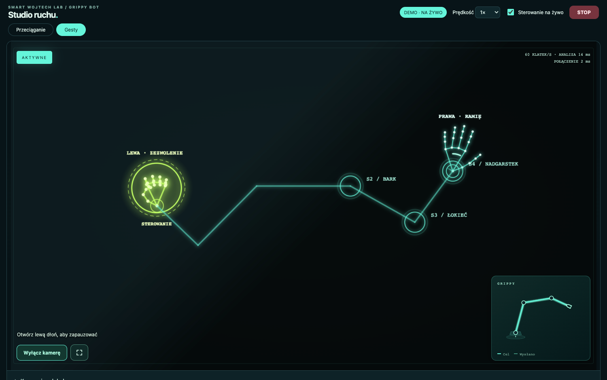
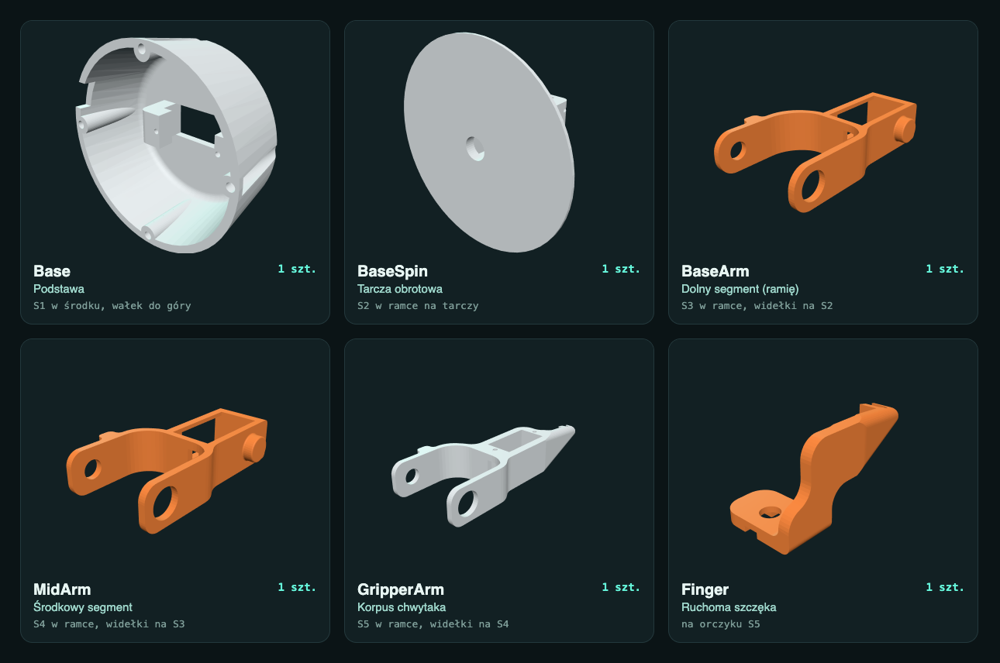
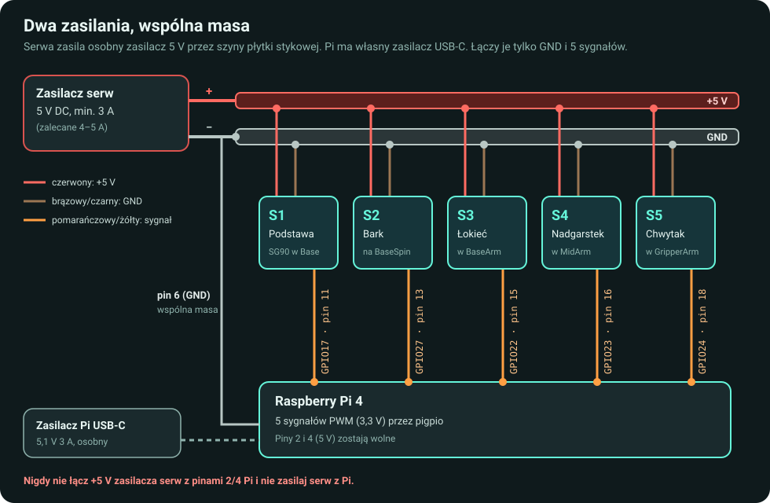
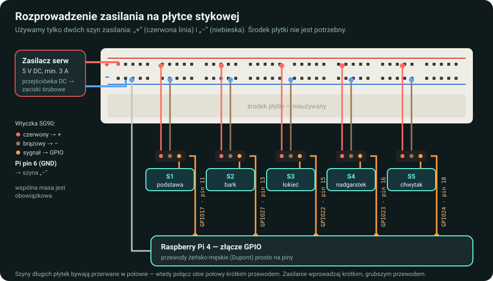
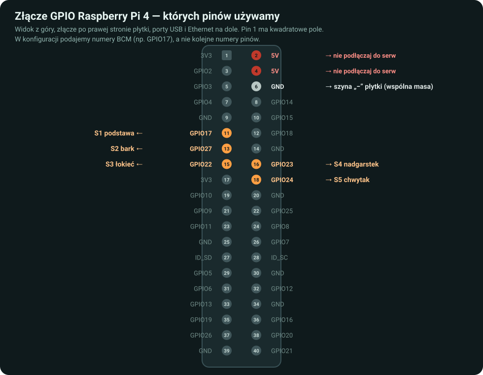
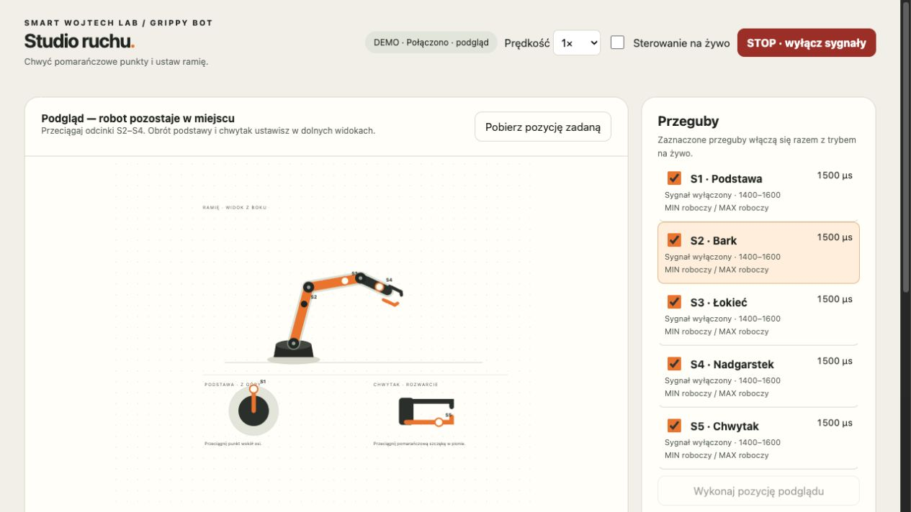
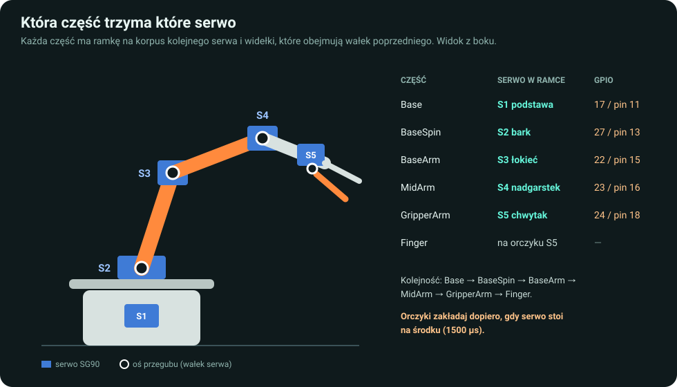
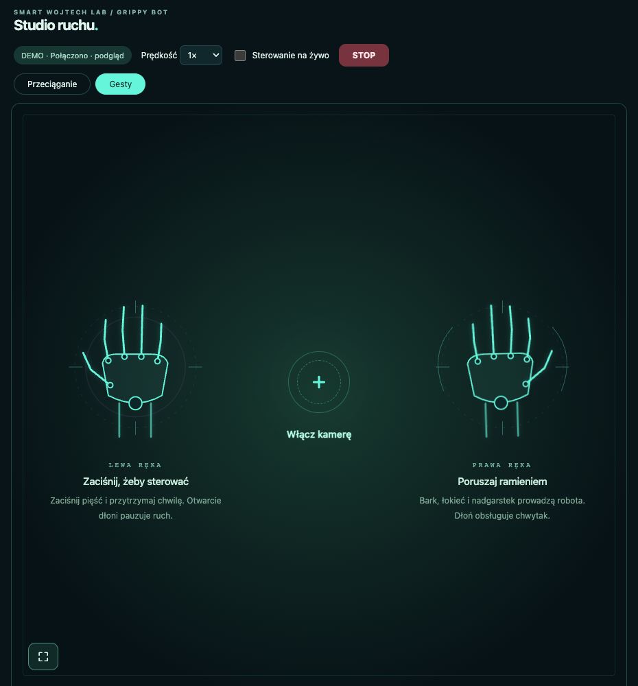

# Grippy Bot — ramię robota sterowane ręką przed kamerą

Kompletny poradnik od wydruku 3D do robota, który naśladuje ruchy Twojej ręki. Drukujesz 6 części, wkładasz 5 tanich serw SG90, podłączasz je do Raspberry Pi 4 i sterujesz z przeglądarki: **gestami z kamery komputera** albo przeciągając przeguby myszą.

- Rozpoznawanie dłoni działa lokalnie w przeglądarce (MediaPipe). Obraz z kamery nigdzie nie jest wysyłany.
- Nie potrzebujesz konta w chmurze, aplikacji mobilnej ani płatnego API.
- Wszystko jest w tym repozytorium: pliki STL do druku, schematy połączeń, program i instrukcja po polsku.



## Spis treści

0. [Wypróbuj bez robota (5 minut)](#0-wypróbuj-bez-robota)
1. [Lista zakupów](#1-lista-zakupów)
2. [Druk 3D](#2-druk-3d)
3. [Połączenia elektryczne](#3-połączenia-elektryczne)
4. [Przygotuj Raspberry Pi](#4-przygotuj-raspberry-pi)
5. [Zainstaluj program na Pi](#5-zainstaluj-program-na-pi)
6. [Otwórz panel na komputerze](#6-otwórz-panel-na-komputerze)
7. [Ustaw serwa na środek](#7-ustaw-serwa-na-środek-przed-montażem)
8. [Złóż ramię](#8-złóż-ramię)
9. [Kalibracja zakresów](#9-kalibracja-zakresów)
10. [Sterowanie gestami](#10-sterowanie-gestami)
11. [Codzienne uruchamianie i wyłączanie](#11-codzienne-uruchamianie-i-wyłączanie)
12. [Gdy coś nie działa](#12-gdy-coś-nie-działa)

Wolisz, żeby asystent AI poprowadził Cię przez instalację? Zobacz [Instalacja z pomocą agenta](#instalacja-z-pomocą-agenta).

---

## 0. Wypróbuj bez robota

Na Macu albo komputerze z Linuxem, z Pythonem 3.10 lub nowszym:

```bash
git clone https://github.com/wojtre/grippybot-control.git
cd grippybot-control
python3 -m grippy_control --simulate
```

Otwórz **http://127.0.0.1:8765**. Napis `DEMO` oznacza, że nic nie jest podłączone. Możesz przeciągać ramię na schemacie. Żeby wypróbować gesty, pobierz raz modele rozpoznawania (ok. 34 MB) i wybierz **Gesty → Włącz kamerę**:

```bash
python3 -m grippy_control.prepare_vision
```

`Ctrl+C` w terminalu zamyka demo. Jeśli port jest zajęty, dodaj `--port 8766`.

---

## 1. Lista zakupów

| Element | Ilość | Uwagi |
| --- | ---: | --- |
| **Raspberry Pi 4 Model B** (dowolna pamięć) | 1 | Pi 400 powinno działać tak samo, ale nie było testowane. **Pi 5 nie jest obsługiwane** (inna obsługa GPIO). |
| Karta microSD 16 GB lub większa | 1 | Na system Raspberry Pi OS. |
| Zasilacz do Pi, USB-C 5,1 V / 3 A | 1 | Najlepiej oficjalny. Pi zasilamy osobno od serw. |
| **Serwo SG90 180°** (pozycyjne) | 5 (+1 zapas) | Nie kupuj wersji „360°/continuous” — ona się kręci w kółko i nie trzyma pozycji. W zestawie są orczyki i śrubki. |
| Zasilacz serw **5 V DC, min. 3 A** (lepiej 4–5 A) | 1 | Z wtykiem 5,5 × 2,1 mm. Pięć SG90 przy obciążeniu potrafi chwilowo pobrać ponad 3 A. |
| Przejściówka DC 5,5 × 2,1 mm (gniazdo) → zaciski śrubowe | 1 | Żeby wpiąć zasilacz w płytkę stykową. |
| Płytka stykowa z szynami zasilania (400 lub 830 pól) | 1 | Używamy tylko szyn „+” i „−”. |
| Przewody Dupont męsko-męskie | ok. 12 | Zasilanie serw → szyny płytki. |
| Przewody Dupont męsko-żeńskie | ok. 6 | Sygnały serw → piny Pi oraz GND Pi → płytka. |
| Filament PLA | 1 szpula | Części są małe — dokładne zużycie pokaże slicer. |
| Klej cyjanoakrylowy (CA, „kropelka”) | trochę | Do przyklejenia orczyka pod tarczą obrotową. |
| Kamera | 1 | Wbudowana w laptopa wystarczy. Do gestów, nie podłączasz jej do Pi. |

**Narzędzia:** mały śrubokręt krzyżakowy, nożyk modelarski lub pilnik (do dopasowania ciasnych gniazd), opcjonalnie multimetr do sprawdzenia zasilacza.

> **Wskazówka:** na nadgarstek możesz dać serwo **MG90S** (ten sam rozmiar i złącze, metalowe zębatki). Nadgarstek dźwiga cały chwytak, a plastikowe zębatki SG90 mają luz, przez który ramię potrafi chwilę „tańczyć” po zatrzymaniu.

---

## 2. Druk 3D

Pliki STL są w tym repozytorium w folderze [`hardware/stl/`](hardware/stl/). Każdy plik możesz obejrzeć w 3D bezpośrednio na GitHubie — wystarczy go kliknąć. Pobierzesz je razem z repozytorium (`git clone` albo **Code → Download ZIP**).



| Plik | Co to jest | Ilość |
| --- | --- | ---: |
| [`Base.STL`](hardware/stl/Base.STL) | Podstawa, w środku serwo S1 | 1 |
| [`BaseSpin.STL`](hardware/stl/BaseSpin.STL) | Tarcza obrotowa, na niej serwo S2 | 1 |
| [`BaseArm.STL`](hardware/stl/BaseArm.STL) | Dolny segment ramienia, w nim serwo S3 | 1 |
| [`MidArm.STL`](hardware/stl/MidArm.STL) | Środkowy segment, w nim serwo S4 | 1 |
| [`GripperArm.STL`](hardware/stl/GripperArm.STL) | Korpus chwytaka z nieruchomą szczęką, w nim serwo S5 | 1 |
| [`Finger.STL`](hardware/stl/Finger.STL) | Ruchoma szczęka chwytaka | 1 |

Każdą część drukujesz **jeden raz**. Opis oryginału wspomina o ośmiu częściach, ale komplet składa się z tych sześciu modeli.

**Ustawienia, na których drukowaliśmy** (Bambu Lab A1, dysza 0,4 mm, ale zadziała każda drukarka FDM):

| Ustawienie | Wartość |
| --- | --- |
| Materiał | PLA |
| Wysokość warstwy | 0,2 mm |
| Ściany | 3 |
| Wypełnienie | 25 % (gyroid) |
| Podpory | tak, drzewiaste (tree), automatyczne |
| Skala | 100 % — nie skaluj, gniazda są dopasowane do SG90 |

**Ułożenie na stole:**

- `Base` — otwartą stroną do góry, płaską zamkniętą powierzchnią do stołu.
- `BaseSpin` — płaską tarczą do stołu.
- `BaseArm`, `MidArm`, `GripperArm` — na płaskim boku.
- `Finger` — płaską boczną powierzchnią do stołu.

Wszystkie części mieszczą się na jednym stole 256 × 256 mm. Po wydruku usuń podpory i sprawdź, czy SG90 wchodzi w każdą prostokątną ramkę. Gniazda są celowo ciasne. Jeśli serwo nie wchodzi, delikatnie poszerz ramkę nożykiem lub pilnikiem — nie wciskaj na siłę, bo wydruk pęknie.

---

## 3. Połączenia elektryczne

Wszystkie połączenia rób **przy odłączonych obu zasilaczach**.

### Zasada: dwa zasilania, wspólna masa



- Serwa zasila **osobny zasilacz 5 V**. Raspberry Pi ma **własny zasilacz USB-C**.
- Minus zasilacza serw, minus wszystkich serw i **pin 6 (GND) Raspberry Pi** muszą być połączone. Bez wspólnej masy serwa nie zrozumieją sygnału i będą drgać.
- **Nigdy** nie łącz plusa zasilacza serw z pinami 2 lub 4 (5 V) Raspberry Pi i nie zasilaj serw z Pi.
- Do Pi idą tylko pomarańczowe/żółte przewody sygnałowe (po jednym na serwo) i jeden przewód GND.

### Płytka stykowa



1. Wkręć przewody do przejściówki DC: czerwony do `+`, czarny do `−`. Drugie końce wepnij w szynę „+” (czerwona linia) i „−” (niebieska linia) płytki.
2. Każde serwo ma wtyczkę z trzema przewodami. Do wtyczki wsuń trzy przewody Dupont:
   - **czerwony** (+5 V) → przewód męsko-męski do szyny „+”,
   - **brązowy** (GND) → przewód męsko-męski do szyny „−”,
   - **pomarańczowy** (sygnał) → przewód męsko-żeński prosto na pin Raspberry Pi z tabeli niżej.
3. Przewodem męsko-żeńskim połącz **pin 6 (GND)** Raspberry Pi z szyną „−”.
4. W długich płytkach (830 pól) szyny bywają przerwane w połowie — połącz obie połówki krótkim przewodem albo wepnij wszystko w jedną połowę.

Kolory przewodów sprawdź na swoich serwach — to wskazówka, nie gwarancja. Zamiast płytki stykowej możesz rozprowadzić zasilanie złączkami (np. dźwigniowymi) — zasada połączeń jest identyczna.

### Piny Raspberry Pi



| Serwo | Przegub | GPIO (BCM) | Fizyczny pin |
| --- | --- | ---: | ---: |
| S1 | podstawa (obrót) | 17 | 11 |
| S2 | bark | 27 | 13 |
| S3 | łokieć | 22 | 15 |
| S4 | nadgarstek | 23 | 16 |
| S5 | chwytak | 24 | 18 |
| — | wspólna masa GND | — | 6 |

Program używa numerów **GPIO (BCM)**, a nie kolejnych numerów pinów. Pin 1 rozpoznasz po kwadratowym polu lutowniczym. Oznacz każde serwo i jego przewody naklejką S1–S5 — przy montażu łatwo je pomylić. Inne piny ustawisz w `config.json` (wzór: [`config.example.json`](config.example.json)).

---

## 4. Przygotuj Raspberry Pi

Na swoim komputerze:

1. Uruchom oficjalny [Raspberry Pi Imager](https://www.raspberrypi.com/software/).
2. Wybierz **Raspberry Pi 4** i system **Raspberry Pi OS Lite (64-bit), Legacy / Bookworm**. Jeśli nie ma go na liście, weź obraz Bookworm z [archiwum Raspberry Pi](https://downloads.raspberrypi.com/raspios_lite_arm64/images/). Instalator programu działa tylko na Bookworm.
3. W ustawieniach (koło zębate / „Edit settings”) wpisz nazwę komputera, np. `grippybot`, **własny login i hasło**, włącz **SSH** i ustaw Wi-Fi z krajem `PL` (albo użyj kabla Ethernet).
4. Zapisz system na karcie (wymazuje kartę), włóż ją do Pi i podłącz zasilacz USB-C Pi. Poczekaj ok. 2 minuty.

W przykładach dalej używamy loginu **`robot`** i nazwy **`grippybot.local`** — zastąp je swoimi. Otwórz Terminal (Mac/Linux) albo PowerShell (Windows) i zaloguj się:

```bash
ssh robot@grippybot.local
```

Przy pierwszym połączeniu potwierdź klucz hosta (`yes`). Podczas wpisywania hasła terminal nie pokazuje znaków — to normalne. Jeśli `.local` nie działa, znajdź adres Pi w routerze i użyj `ssh robot@ADRES_IP`.

---

## 5. Zainstaluj program na Pi

Zasilacz serw zostaw na razie odłączony. W terminalu zalogowanym do Pi:

```bash
sudo apt update
sudo apt install -y git
git clone https://github.com/wojtre/grippybot-control.git
cd grippybot-control
bash scripts/install-pi.sh --dry-run
```

Ostatnie polecenie tylko pokazuje plan. Jeśli wygląda dobrze, zainstaluj:

```bash
bash scripts/install-pi.sh
```

Instalator sam poprosi o hasło do `sudo` — **nie uruchamiaj go przez `sudo bash`**. Instaluje `pigpio`, tworzy środowisko Pythona, plik `config.json` i dwie usługi, które startują same po włączeniu Pi:

| Usługa | Zadanie |
| --- | --- |
| `grippy-pigpiod` | Generuje sprzętowo impulsy serw. Dostępna tylko lokalnie, port 8889. |
| `grippy-panel` | Panel w przeglądarce. Dostępny tylko lokalnie, port 8765. |

**Start Pi i otwarcie panelu nie poruszają serwami.** Sprawdź, czy wszystko działa:

```bash
systemctl is-active grippy-pigpiod grippy-panel
.venv/bin/python scripts/doctor.py
```

Obie usługi powinny pokazać `active`. Na koniec pobierz modele do sterowania gestami (raz, ok. 34 MB):

```bash
.venv/bin/python -m grippy_control.prepare_vision
```

---

## 6. Otwórz panel na komputerze

Panel działa na Pi, ale otwierasz go w przeglądarce na komputerze przez **tunel SSH**. Otwórz **drugi terminal na komputerze** (nie w Pi) i wpisz:

```bash
ssh -N -o ExitOnForwardFailure=yes -o ServerAliveInterval=15 -o ServerAliveCountMax=3 -L 127.0.0.1:8765:127.0.0.1:8765 robot@grippybot.local
```

Po zalogowaniu terminal nic nie wypisuje — tak ma być, zostaw go otwartego. W przeglądarce (najlepiej Chrome) otwórz **http://127.0.0.1:8765**.

Na Macu/Linuxie z pobranym repozytorium to samo zrobisz krócej: `bash scripts/connect.sh robot@grippybot.local`.

Nie wpisuj w przeglądarce adresu IP Pi — panel celowo nie jest widoczny w sieci. Nie wystawiaj portów 8765 i 8889 do internetu.



---

## 7. Ustaw serwa na środek przed montażem

Każde serwo ustawiasz na środek zakresu (**1500 µs**), **zanim** założysz na nie orczyk. Dzięki temu ramię ma tyle samo ruchu w obie strony.

1. Zdejmij orczyki ze wszystkich serw. Podłącz zasilacz serw.
2. W panelu, w sekcji **Przeguby i kalibracja serw**, odznacz wszystkie przeguby oprócz jednego, np. S1. Ustaw prędkość `1×`.
3. Zaznacz u góry **Sterowanie na żywo**. Zaznaczone serwo ustawi się na 1500 µs i będzie trzymać pozycję.
4. Kliknij **STOP** (albo `Escape`). Przypnij do serwa karteczkę „środek OK”.
5. Powtórz dla S2–S5. Nie obracaj potem wałków ręką.

---

## 8. Złóż ramię



Każda część ma prostokątną **ramkę** na korpus serwa i **widełki**, które obejmują wałek serwa poprzedniego przegubu. Montuj przy odłączonym zasilaczu serw.

1. **Podstawa (S1):** wsuń S1 w gniazdo `Base` — korpus do środka, wałek do góry. Przewód wyprowadź wycięciem, tak żeby nie był ściśnięty.
2. **Tarcza (S2):** przyłóż okrągły orczyk S1 do spodu `BaseSpin`, wycentruj go względem otworu i przyklej klejem CA (tylko styk orczyk–wydruk, z dala od wałka). Po wyschnięciu nałóż tarczę na wałek S1 i przykręć środkową śrubką. Tarcza ma obracać się bez tarcia o podstawę. Następnie włóż S2 poziomo w ramkę na tarczy — wałkiem na bok — i przykręć śrubkami z zestawu.
3. **Bark (S3):** nałóż widełki `BaseArm` na wałek S2 z orczykiem. Segment ma stać mniej więcej pionowo przy 1500 µs. Włóż S3 w ramkę `BaseArm`.
4. **Łokieć (S4):** nałóż widełki `MidArm` na S3, włóż S4 w ramkę `MidArm`.
5. **Nadgarstek (S5):** nałóż widełki `GripperArm` na S4, włóż S5 w ramkę `GripperArm`.
6. **Chwytak:** przykręć orczyk do płaskiej części `Finger` i nałóż ją na wałek S5 tak, żeby przy 1500 µs szczęka była **częściowo otwarta** — nie może dotykać nieruchomej szczęki.

Wskazówki:

- Każdy orczyk dociśnij środkową śrubką z kompletu SG90. Jeśli ma luz w gnieździe wydruku, podklej go kroplą kleju CA — ale nigdy nie klej korpusu serwa do ruchomych widełek.
- Nie dokręcaj śrub na siłę — zębatki SG90 są plastikowe.
- Zostaw przewodom luz przy przegubach, żeby ramię nie ciągnęło kabli przy ruchu.
- Przy pierwszym uruchomieniu podeprzyj ramię i nie wkładaj nic do chwytaka.

---

## 9. Kalibracja zakresów

Każdy złożony robot ma trochę inny bezpieczny zakres ruchu. Program startuje z ostrożnym zakresem **1400–1600 µs** dla każdego przegubu. Rozszerzasz go sam, po jednym przegubie:

1. Zaznacz jeden przegub i włącz **Sterowanie na żywo**, potem je wyłącz — sygnał zostaje aktywny.
2. Przyciskami **−100 / +100 µs** sprawdzaj, jak daleko przegub może się ruszyć. **Zatrzymaj się przed oporem** — gdy serwo dociska do mechanicznej blokady, buczy, grzeje się i drga.
3. Kliknij **Zapisz MIN** albo **Zapisz MAX**. Zostaw kilkadziesiąt µs zapasu od miejsca, w którym coś zaczyna ocierać.
4. Powtórz dla pozostałych przegubów.

Kalibracja zapisuje się w `data/ranges.json` na Pi i nie jest nadpisywana przy aktualizacji. Szczegóły: [instrukcja panelu i kalibracji](docs/usage.md).

---

## 10. Sterowanie gestami

W panelu wybierz zakładkę **Gesty → Włącz kamerę** i zezwól przeglądarce na kamerę. Stań tak, żeby kamera widziała oba barki, łokieć prawej ręki i obie dłonie.



| Ruch | Co robi robot |
| --- | --- |
| **Lewa dłoń w pięść**, przytrzymaj ok. 0,3 s | Robot zaczyna naśladować prawą rękę |
| **Otwarta lewa dłoń** | Natychmiastowa pauza — pozycja i chwyt zostają |
| Prawy nadgarstek w bok względem barków | Obrót podstawy S1 |
| Unoszenie / opuszczanie prawego ramienia | Bark S2 |
| Zginanie prawego łokcia | Łokieć S3 |
| Zginanie prawej dłoni względem przedramienia | Nadgarstek S4 |
| **Prawa dłoń otwarta / w pięść** | Chwytak otwiera się / zamyka (S5) |

- Bez **Sterowania na żywo** porusza się tylko schemat w panelu — możesz bezpiecznie poćwiczyć.
- Przy każdej dłoni widać jej rolę („LEWA · ZEZWOLENIE”, „PRAWA · RAMIĘ”). Na dole ekranu pojawiają się podpowiedzi, co poprawić.
- Trzymaj prawą dłoń mniej więcej w płaszczyźnie obrazu. Gdy kierujesz ją prosto w kamerę, nadgarstek celowo się zatrzymuje, bo kąta nie da się wtedy wiarygodnie zmierzyć.
- Jeśli podgląd myli lewą i prawą rękę, Twoja kamera sama odbija obraz — zaznacz **Kamera odbija obraz** w ustawieniach kamery.
- Ręce możesz zamienić (lewa steruje) w **Dopasuj sterowanie i skalibruj ruchy**. Tam też ustawisz czułość i kierunek każdej osi.

Więcej: [sterowanie gestami — szczegóły](docs/gestures.md).

---

## 11. Codzienne uruchamianie i wyłączanie

**Start:**

1. Włącz Pi i poczekaj ok. minuty. Usługi wystartują same.
2. Na komputerze uruchom tunel z punktu 6 i otwórz http://127.0.0.1:8765.
3. Sprawdź, czy ramię ma wolną drogę, podłącz zasilacz serw i dopiero wtedy włącz **Sterowanie na żywo**.

**Koniec:**

1. Podeprzyj ramię i kliknij **STOP**.
2. Odłącz zasilacz serw.
3. Wyłącz Pi poleceniem na Pi i poczekaj, aż zgaśnie zielona dioda, zanim odłączysz zasilanie:

```bash
sudo shutdown -h now
```

**Ważne o bezpieczeństwie:** STOP / `Escape` wyłącza sygnały serw, ale **nie odcina zasilania** — to nie jest wyłącznik awaryjny. Zamknięcie strony lub zerwanie SSH nie zatrzymuje robota: dokończy ostatni ruch i będzie trzymał pozycję. Nie zostawiaj włączonego robota bez nadzoru.

---

## 12. Gdy coś nie działa

| Objaw | Co sprawdzić |
| --- | --- |
| `ssh` nie łączy się z `grippybot.local` | Pi musi być w tej samej sieci. Użyj adresu IP z routera. Sprawdź login ustawiony w Imagerze. |
| Panel nie otwiera się w przeglądarce | Czy terminal z tunelem SSH jest nadal otwarty? Na Pi: `systemctl is-active grippy-pigpiod grippy-panel`. |
| Przegub się nie rusza | Czy nie jesteś w `DEMO`? Czy przegub jest zaznaczony i włączone jest Sterowanie na żywo? Czy jest wspólna masa (pin 6)? |
| Wszystkie serwa drgają lub ruszają się same | Brak wspólnej masy, za słaby zasilacz serw albo luźny przewód na płytce. |
| Jedno serwo „tańczy” kilka sekund po zatrzymaniu | Program wysyła wtedy stały impuls — to luz w zębatkach i ciężar chwytaka albo zużyte serwo. Zamień serwo z innym; na nadgarstek daj MG90S. |
| Serwo buczy i grzeje się na końcu ruchu | Dociska do mechanicznej blokady — zmniejsz MIN/MAX tego przegubu. |
| Gesty nie startują robota | Zobacz podpowiedź na dole obrazu i sekcję **Diagnostyka gestów** w panelu. |

Pełna lista problemów i rozwiązań: [rozwiązywanie problemów](docs/troubleshooting.md).

---

## Instalacja z pomocą agenta

Instalację oprogramowania możesz przejść z asystentem **Claude Code** lub **Codex**, korzystając z dołączonego skilla [`grippybot-setup`](skills/grippybot-setup/SKILL.md). Agent dobierze polecenia do Twojego loginu i hosta, zainstaluje program, zestawi tunel i sprawdzi panel. Otwórz repozytorium w wybranym narzędziu i napisz:

```text
Przeczytaj skills/grippybot-setup/SKILL.md i pomóż mi zainstalować ten
kontroler na Raspberry Pi 4. Wyjaśniaj kroki dla początkującego i zaznaczaj,
które polecenia wykonujemy na komputerze, a które na Pi. Nie wykonuj ruchów robota.
```

Druk, montaż, przewody i wpisywanie haseł pozostają po Twojej stronie. [Jak zainstalować skill](docs/agents.md).

## Co jest w repozytorium

| Ścieżka | Zawartość |
| --- | --- |
| [`hardware/stl/`](hardware/stl/) | Pliki STL do druku 3D |
| [`docs/`](docs/) | Schematy, instrukcje szczegółowe, rozwiązywanie problemów |
| [`grippy_control/`](grippy_control/) | Program: sterowanie serwami, serwer i panel w przeglądarce, gesty |
| [`scripts/`](scripts/) | Instalator na Pi, usługi, tunel SSH, diagnostyka |
| [`config.example.json`](config.example.json) | Wzór nazw przegubów i pinów |
| [`skills/grippybot-setup/`](skills/grippybot-setup/) | Skill dla Claude Code / Codex |
| [`docs/development.md`](docs/development.md) | Dla programistów: testy, API, aktualizacja |

`config.json`, `data/`, hasła, klucze SSH i logi zostają tylko u Ciebie — nie dodawaj ich do Gita.

## Autorzy, podziękowania i licencje

- **Program, schematy i instrukcja:** Smart Wojtech Lab, przy pomocy Claude Code i Codex. Licencja [MIT](LICENSE).
- **Mechanika Grippy Bot:** projekt [Roboteurs](https://roboteurs.com/), udostępniony na [Cults3D](https://cults3d.com/en/3d-model/gadget/grippy-bot) na licencji [CC BY-NC 4.0](https://creativecommons.org/licenses/by-nc/4.0/) — możesz drukować i udostępniać, podając autora, ale **nie do celów komercyjnych**. Pliki w [`hardware/stl/`](hardware/stl/) są niezmienionymi plikami autora. Szczegóły: [`hardware/stl/LICENSE.md`](hardware/stl/LICENSE.md).
- **Inspiracja:** repozytorium [AryanMadhavVerma/grippybot](https://github.com/AryanMadhavVerma/grippybot) — uczenie przez naśladowanie na tym samym ramieniu, z tym samym układem pinów GPIO.
- **Biblioteki:** [pigpio](https://github.com/joan2937/pigpio) (impulsy serw), [MediaPipe](https://ai.google.dev/edge/mediapipe) (rozpoznawanie dłoni i sylwetki, Apache 2.0).

Testy automatyczne działają na symulowanych serwach. Sterowanie sprawdzono na fizycznym robocie z Pi 4 / Bookworm. Pełna instalacja od czystej karty przez niezależną osobę nie została jeszcze przeprowadzona — jeśli coś nie zadziała, zgłoś to w zakładce **Issues**.
