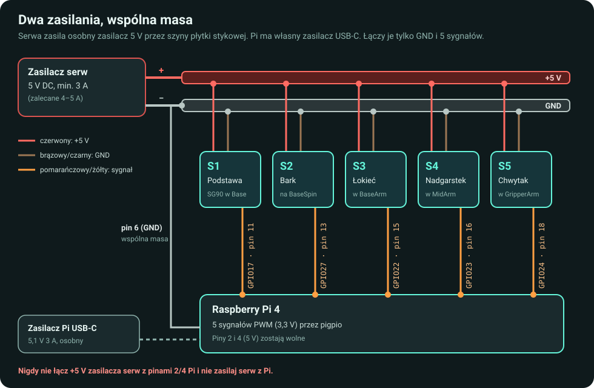
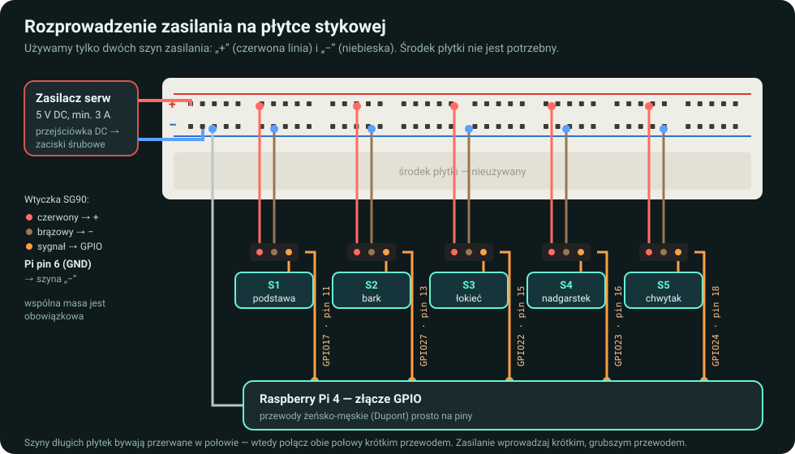
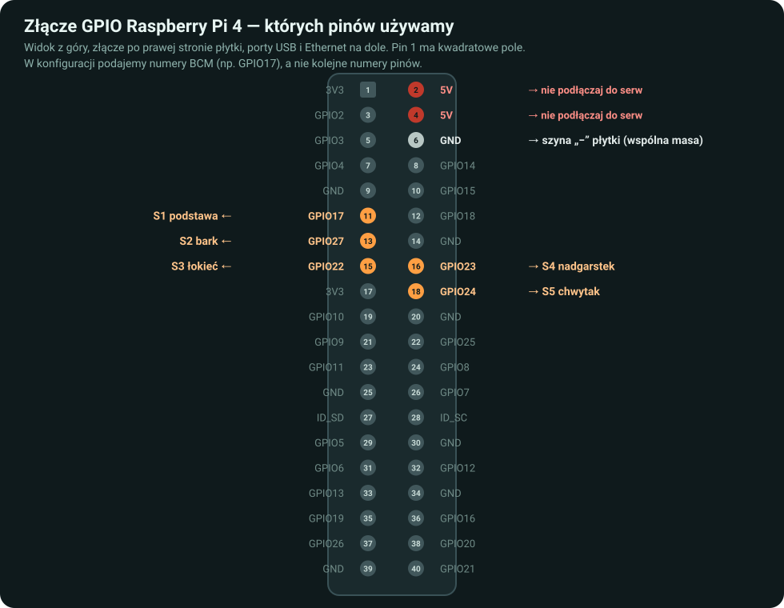

# Podłączenie: osobne zasilanie, wspólna masa

Skrócona wersja jest w [README](../README.md#3-połączenia-elektryczne). Tutaj szczegóły.
Zasilacz serw odłącz podczas pracy z przewodami. Przed pierwszym podłączeniem sprawdź
napięcie i polaryzację zasilacza (multimetrem albo według oznaczeń na etykiecie).
Fizyczne pasowanie wtyczki nie potwierdza zgodności elektrycznej.





```text
ZASILACZ SERW 5 V
  plus  ─────── szyna „+” płytki ───── czerwone przewody wszystkich serw
  minus ─────── szyna „−” płytki ──┬── brązowe przewody wszystkich serw
                                   └── GND Raspberry Pi (fizyczny pin 6)

RASPBERRY PI (zasilane własnym zasilaczem przez USB-C)
  GPIO 17 / pin 11 ──────────────── sygnał S1 (podstawa)
  GPIO 27 / pin 13 ──────────────── sygnał S2 (bark)
  GPIO 22 / pin 15 ──────────────── sygnał S3 (łokieć)
  GPIO 23 / pin 16 ──────────────── sygnał S4 (nadgarstek)
  GPIO 24 / pin 18 ──────────────── sygnał S5 (chwytak)
```



Sygnał w typowym SG90 jest pomarańczowy lub żółty. Sprawdź oznaczenia konkretnego serwa — kolor to wskazówka, nie pomiar.

- Wszystkie serwa zasilasz **równolegle** z szyn płytki, nie szeregowo.
- Zasilacz serw i Pi mają wspólny GND. Nie łącz plusa zasilacza serw z pinem 2 ani 4 (5 V) Pi.
- GPIO Pi pracuje z logiką 3,3 V. Przewód sygnałowy serwa tylko odbiera polecenie; nie podawaj na GPIO zewnętrznych 5 V.
- Styki płytki stykowej i cienkie przewody Dupont mają ograniczoną obciążalność. Zasilanie z przejściówki DC doprowadź krótkimi, możliwie grubymi przewodami. Jeśli szyny się nagrzewają albo serwa słabną przy ruchu kilku przegubów naraz, rozprowadź zasilanie złączkami (np. dźwigniowymi) zamiast płytki — schemat połączeń pozostaje ten sam.
- W długich płytkach szyny bywają przerwane w połowie długości. Sprawdź to multimetrem albo połącz obie połowy mostkiem.
- Numery `GPIO` w kodzie to **BCM**, a nie numery kolejnych nóżek. Fizyczny pin 11 to BCM 17. Nie licz pinów na podstawie przypadkowej orientacji zdjęcia; użyj [oficjalnego opisu złącza GPIO](https://www.raspberrypi.com/documentation/computers/raspberry-pi.html#gpio).

Jeśli używasz innych pinów, edytuj `config.json`. Przykład struktury jest w `config.example.json`. Program wymaga pięciu unikalnych GPIO BCM 2–27 i sam oblicza fizyczne numery pinów. Wolny numer w konfiguracji nie oznacza, że ten GPIO nie jest zajęty przez inną funkcję systemu (np. UART/SPI/I²C).

**Drgania:** najpierw sprawdź połączenia i napięcie pod obciążeniem, a potem pojedyncze, odciążone serwo z pozostałymi fizycznie odłączonymi. Sam STOP wyłącza sygnał, lecz zasilanie pozostaje. Więcej: [diagnostyka](troubleshooting.md).
